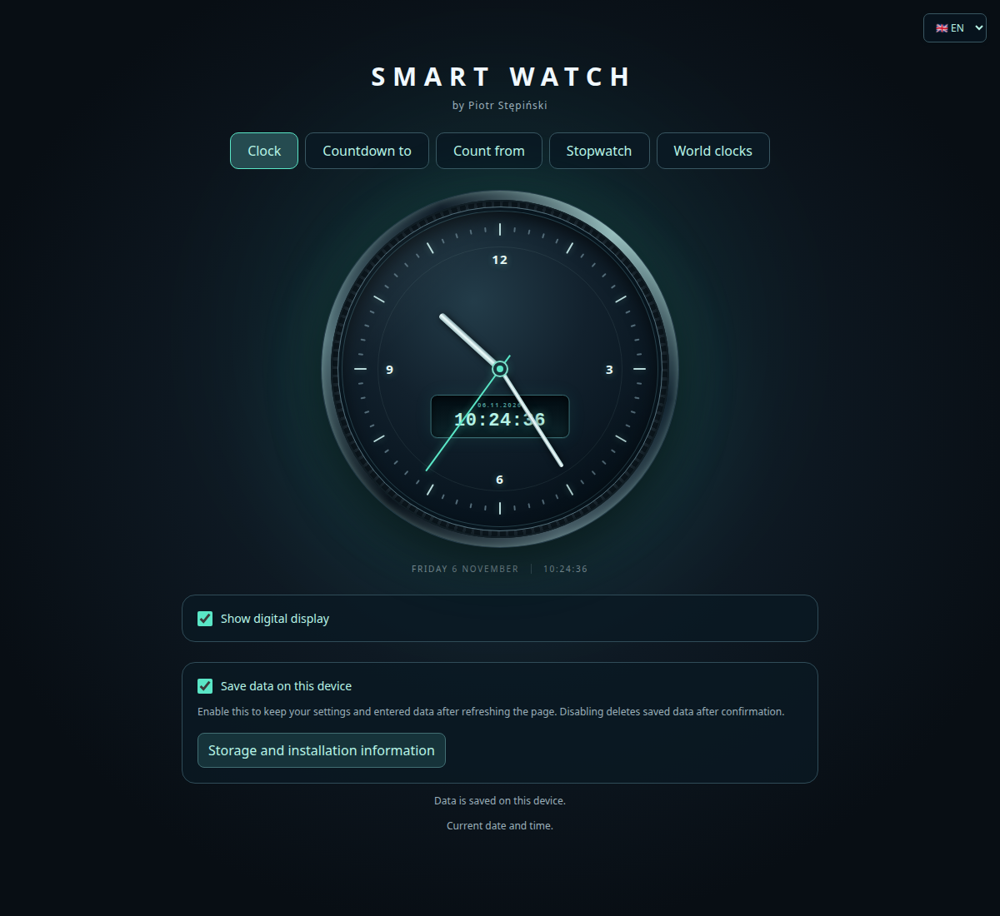
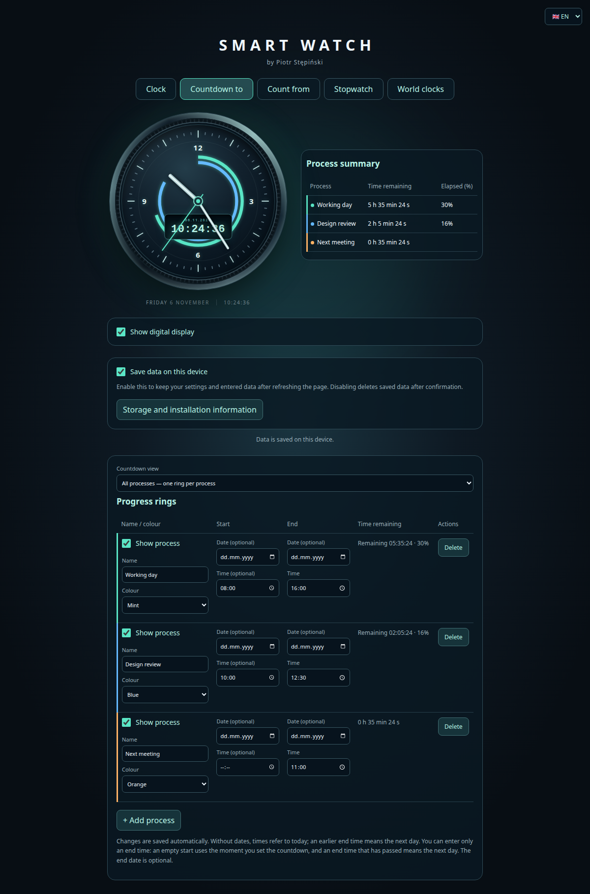
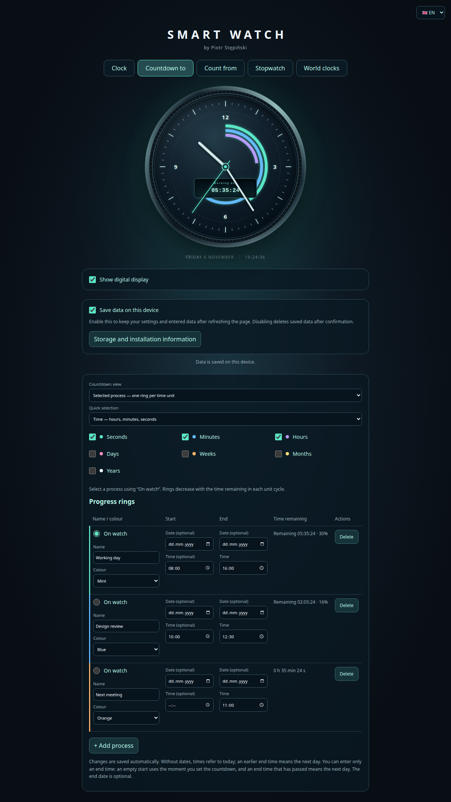
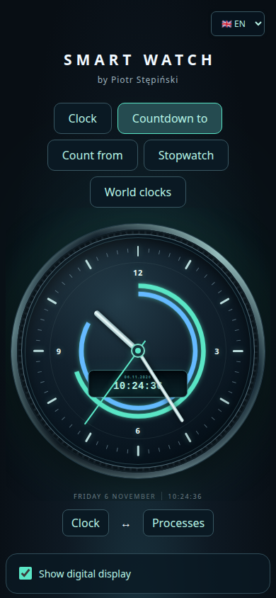
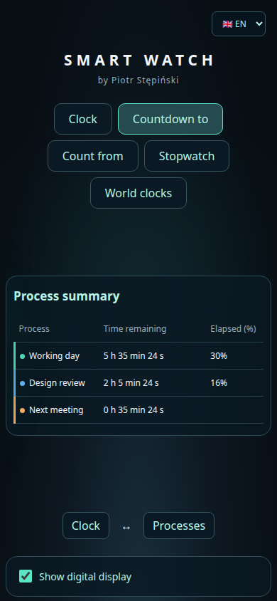
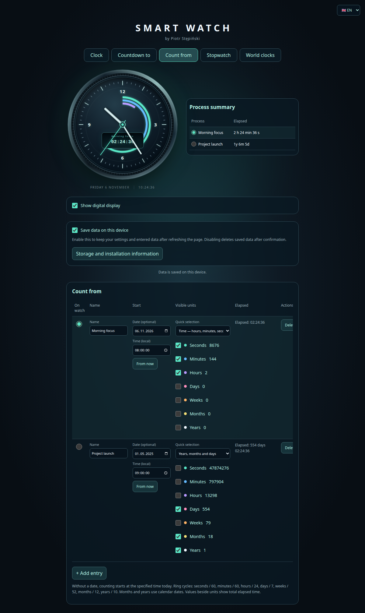
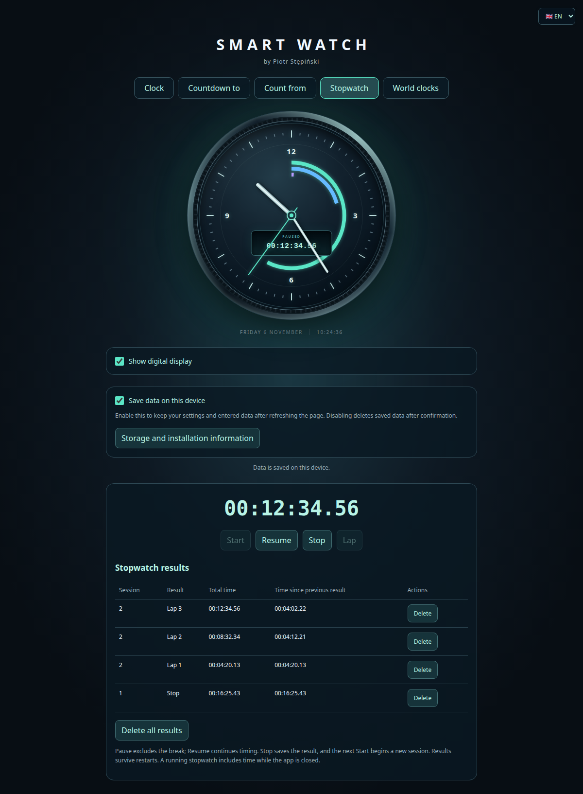
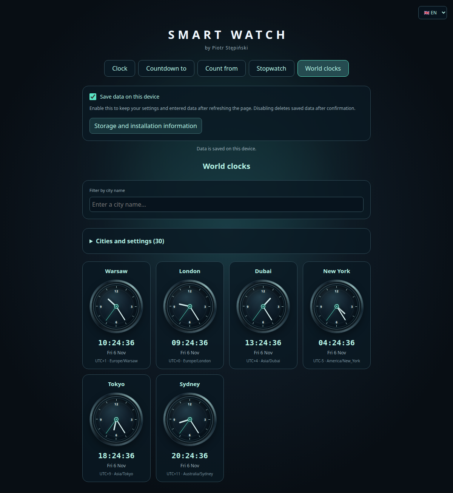
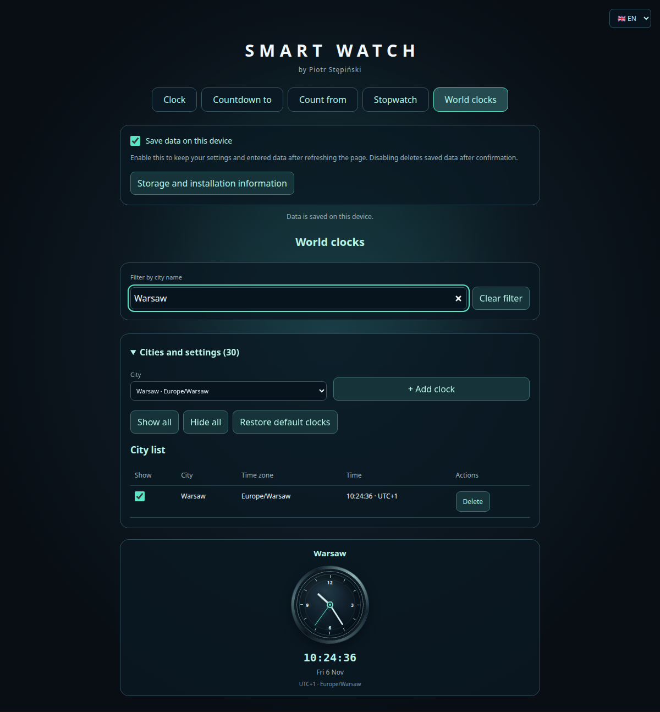
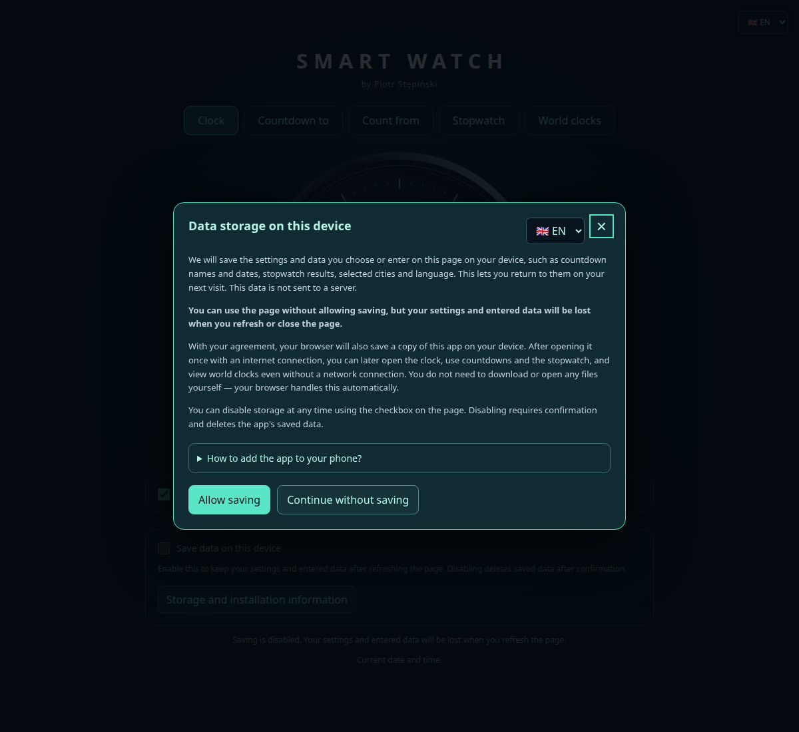

# SMART WATCH

**by Piotr Stępiński**

Zegarek analogowo-cyfrowy, odliczanie do i od wybranego momentu, stoper z okrążeniami oraz zegary świata. Aplikacja jest napisana w Angularze, działa jako PWA i po zgodzie użytkownika zapisuje ustawienia na urządzeniu. Interfejs obsługuje **PL i EN**.

## Spis treści

- [Uruchomienie projektu](#uruchomienie-projektu)
- [Wspólne funkcje i obsługa](#wspólne-funkcje-i-obsługa)
- [Zegarek / Clock](#zegarek--clock)
- [Odliczanie do / Countdown to](#odliczanie-do--countdown-to)
- [Odliczanie od / Count from](#odliczanie-od--count-from)
- [Stoper / Stopwatch](#stoper--stopwatch)
- [Zegary świata / World clocks](#zegary-świata--world-clocks)
- [Jednostki czasu i zasady obliczeń](#jednostki-czasu-i-zasady-obliczeń)
- [Zapis danych i restart](#zapis-danych-i-restart)
- [PWA: instalacja, offline i aktualizacje](#pwa-instalacja-offline-i-aktualizacje)
- [Testy i odtwarzanie zrzutów ekranu](#testy-i-odtwarzanie-zrzutów-ekranu)
- [Struktura projektu](#struktura-projektu)

## Uruchomienie projektu

Wszystkie polecenia wykonuj w katalogu repozytorium, chyba że zaznaczono inaczej.

### Docker Compose

Wymagany jest działający Docker Engine lub Docker Desktop z wtyczką `docker compose` obsługującą `up --wait`. Nie trzeba instalować Node.js na komputerze: obraz buduje aplikację w kontenerze Node, a gotowe pliki serwuje Nginx.

```bash
./scripts/start.sh
```

Aplikacja: **http://localhost:4173**.

Skrypt buduje aktualny kod, uruchamia usługę `web` w tle i czeka na pozytywny healthcheck. Ponowne wykonanie skryptu przebudowuje obraz i zastępuje kontener, jeżeli obraz się zmienił. Skrypty można wywoływać także spoza katalogu projektu, podając ich ścieżkę.

Zatrzymanie i usunięcie kontenera oraz sieci projektu:

```bash
./scripts/stop.sh
```

Inny port:

```bash
HORIZON_PORT=8090 ./scripts/start.sh
HORIZON_PORT=8090 ./scripts/stop.sh
```

Przy niestandardowym porcie aplikacja jest dostępna pod `http://localhost:8090`. Komunikat skryptu startowego przypomina adres domyślny; właściwe mapowanie można sprawdzić przez `docker compose ps`.

Równoważna obsługa bez skryptów:

```bash
docker compose up -d --build --wait
docker compose ps
docker compose logs -f web
docker compose down
```

Obraz ma dwa etapy: `npm ci` i produkcyjna kompilacja Angulara w `node:24-alpine`, następnie serwowanie `dist/horizon/browser` w `nginx:stable-alpine`. Nginx udostępnia `/healthz`, ponownie weryfikuje cache po wdrożeniu i zwraca 404 dla brakujących zasobów zamiast treści HTML. Kontener ma politykę `restart: unless-stopped`.

Dane użytkownika są w przeglądarce, więc nie wymagają wolumenu Docker. Przebudowanie lub usunięcie kontenera ich nie usuwa. Zmiana portu oznacza jednak inny adres witryny i oddzielny zapis danych.

### Lokalnie, bez Dockera

Wymagane są npm i wersja Node zgodna z `package.json`: **22.22.3+ w linii 22, 24.15+ w linii 24 lub 26+**. Zalecana jest linia 24, używana również w Dockerfile.

```bash
npm ci
npm start
```

Tryb deweloperski działa pod **http://localhost:4200**, z aktualizacją kodu podczas pracy. Service worker jest w nim wyłączony.

Wersja produkcyjna do lokalnego sprawdzenia, w tym PWA:

```bash
npm run build
npm run preview
```

Adres: **http://localhost:4173**. Nie uruchamiaj równocześnie `npm run preview` i kontenera na tym samym porcie. Lokalny serwer można zatrzymać przez `Ctrl+C`.

### Hosting i dostęp z telefonu

Publikuj zawartość `dist/horizon/browser` na serwerze statycznym lub użyj kontenera za reverse proxy z **HTTPS**. Bieżąca konfiguracja aplikacji zakłada umieszczenie jej w katalogu głównym domeny.

Do zwykłego otwarcia strony z telefonu w tej samej sieci można użyć adresu komputera i portu 4173. Instalacja i działanie service workera wymagają bezpiecznego kontekstu: HTTPS albo lokalnego `localhost`. Adres `http://192.168.…:4173` nie zastępuje HTTPS, a `localhost` na telefonie wskazuje telefon, nie komputer.

Nie otwieraj plików aplikacji przez `file://`; Angular i PWA wymagają serwera HTTP/HTTPS.

## Wspólne funkcje i obsługa

| Zakładka PL | Zakładka EN | Zastosowanie |
| --- | --- | --- |
| Zegarek | Clock | Aktualny czas urządzenia. |
| Odliczanie do | Countdown to | Czas pozostały do końca jednego lub wielu procesów. |
| Odliczanie od | Count from | Czas od wskazanego momentu dla wielu zapisanych procesów. |
| Stoper | Stopwatch | Pomiar uruchamiany przyciskiem, pauza i okrążenia. |
| Zegary świata | World clocks | Równoczesne zegary wybranych miast. |

- **Zgoda na zapis:** przy pierwszym wejściu pojawia się popup z przyciskami `Allow saving` i `Continue without saving`. Do czasu zgody ustawienia i wyniki są tylko w pamięci karty, bez rejestrowania nowego service workera. Po zgodzie zapisywane są dane i sam wybór, więc popup nie wraca. Po odmowie jest ukryty w bieżącym otwarciu strony; po odświeżeniu lub następnym wejściu wraca.
- **Przełącznik zapisu:** `Save data on this device` jest dostępny we wszystkich zakładkach. Włącza zapamiętywanie; wyłączenie wymaga potwierdzenia usunięcia danych. Anulowanie pozostawia zapis i dane bez zmian. Po potwierdzeniu usuwane są dane, zgoda i pliki offline aplikacji, a ustawienia i pomiary wracają do wartości domyślnych. Nowe zmiany pozostają wyłącznie w pamięci karty. Cofnięcie zgody jest respektowane także w innych otwartych kartach.
- **Język PL/EN:** selektor z flagami 🇵🇱 / 🇬🇧 znajduje się w prawym górnym rogu ekranu; popup ma również własny selektor języka. Przy pierwszym uruchomieniu wybierany jest polski dla języka przeglądarki `pl`, a angielski dla pozostałych języków. Przy włączonym zapisie wybór w selektorze w prawym górnym rogu jest zapamiętywany i ma pierwszeństwo przy kolejnym otwarciu. Tłumaczone są także formularze, komunikaty, nazwy jednostek, gotowe zestawy, daty i etykiety dostępności. Własne nazwy procesów pozostają zachowane.
- **Tarcza:** aktualna godzina jest pokazywana wskazówkami godzinową, minutową i sekundową. Pierścienie są wewnątrz cyfr 12, 3, 6 i 9. Wskazówki nadal pokazują bieżącą godzinę także podczas odliczania i pomiaru stopera; czas procesu prezentują pierścienie i wyświetlacz.
- **Wyświetlacz cyfrowy:** wspólny przełącznik pokazuje lub ukrywa wyświetlacz na głównej tarczy. Wymiary wyświetlacza są takie same w poszczególnych trybach. Położenie zależy od wskazówki godzinowej: przy wskazówce w górnej połowie tarczy wyświetlacz jest na dole, a przy wskazówce w dolnej połowie — na górze. Przełączenie następuje o 3:00 i 9:00 w każdym cyklu 12-godzinnym, we wszystkich trybach z główną tarczą. Długie wartości dopasowują rozmiar tekstu; długa nazwa jest skracana wielokropkiem.
- **Data i godzina pod tarczą:** pokazują bieżący czas urządzenia niezależnie od wybranego procesu.
- **Nawigacja:** zakładki obsługują kliknięcie oraz klawiaturę: strzałki lewo/prawo, `Home` i `End`. Elementy formularzy mają etykiety i widoczny fokus.
- **Małe ekrany:** w widoku wszystkich procesów „Odliczania do” oraz w „Odliczaniu od” zegarek i podsumowanie tworzą przy szerokości do **700 px** dwie karty karuzeli. Przesuwaj palcem w poziomie lub użyj przycisków `Clock` / `Processes`. Na szerokim ekranie tabela stoi obok zegarka. Szerokie tabele edycji można przewijać poziomo.

Zrzuty poniżej pochodzą z działającej aplikacji z interfejsem **EN**, przykładowymi danymi i ustalonym momentem 6 listopada 2026, 10:24:36 w strefie `Europe/Warsaw`. Nie zawierają danych użytkownika.

## Zegarek / Clock

Widok samego zegarka: tarcza analogowa, cyfrowa godzina z sekundami i data. Nie ma pierścieni procesów. Przełącznik wyświetlacza pozwala pozostawić wyłącznie wskazówki; data i godzina pod tarczą pozostają widoczne.



## Odliczanie do / Countdown to

### Procesy i formularz

Można dodawać i usuwać wiele procesów. Każdy ma własną nazwę, początek, koniec i kolor z palety: miętowy, niebieski, fioletowy, różowy, pomarańczowy lub żółty. Domyślny proces ma godziny **08:00–16:00**.

Zmiany są stosowane automatycznie, a przy włączonej zgodzie na zapis również zapamiętywane. Nieprawidłowy lub niekompletny zakres pokazuje komunikat; nie jest rysowany jego pierścień.

| Wprowadzone dane | Zasada działania |
| --- | --- |
| Godzina początku i końca, obie daty puste | Zakres odnosi się do dzisiejszych godzin. Godzina końca wcześniejsza niż początek oznacza następny dzień. |
| Pełny początek i koniec z datami | Jednorazowy zakres, z końcem po początku. |
| Godzina końca, cały początek pusty | Początek jest zapamiętywany jako moment ustawienia zakresu. Miniona godzina końca oznacza następny dzień. |
| Data i godzina końca, cały początek pusty | Odliczanie od zapamiętanego bieżącego momentu do wskazanego celu. |
| Godzina początku bez daty, koniec z datą | Początek jest przyjmowany na dzisiaj o podanej godzinie. |
| Data początku bez godziny lub bez daty końca | Wymaga uzupełnienia danych albo pozostawienia całego początku pustego. |

Zakres bez dat, ale z jawną godziną początku, jest wyznaczany względem **bieżącego dnia**. Natomiast automatycznie zapamiętany początek pozostaje stały po restarcie, a zakończone odliczanie nie przechodzi samo do kolejnej doby. Zmiana pól początku lub końca przy pustym początku zapisuje nowy moment odniesienia; zmiana nazwy lub koloru go nie zmienia.

### Wszystkie procesy

- Niezależne przełączniki `Show process` wybierają procesy widoczne na tarczy i w podsumowaniu.
- Każdy zaznaczony proces **z podaną godziną początku** ma osobny pierścień w swoim kolorze. Pierścień jest pełny przy 0% upływu, maleje wraz z postępem i znika przy 100%.
- Podsumowanie obok tarczy pokazuje nazwę, kolor, czas pozostały w jednostkach i procent upływu. Niezaznaczone procesy nie są w nim wyświetlane.
- Procent oznacza **czas, który już upłynął**, ograniczony do 0–100% i zaokrąglony w dół do liczby całkowitej. Przed początkiem wynosi 0%, a po zakończeniu 100%.
- **Bez godziny początku** proces pokazuje tylko czas pozostały: bez pierścienia i bez procentu. Gdy żaden widoczny proces nie ma godziny początku, kolumna procentów znika.
- Przed rozpoczęciem podsumowanie pokazuje czas do końca, wliczając oczekiwanie na początek.

Na przykładzie `Working day` i `Design review` mają początki oraz pierścienie. `Next meeting` ma tylko godzinę celu, dlatego nie ma procentu ani własnego pierścienia.



### Wybrany proces

Wybierz `Selected process — one ring per time unit`, a następnie wskaż proces opcją `On watch` w tabeli. Na tarczy są pierścienie **jednostek czasu pozostałego do końca**, zamiast pojedynczego pierścienia procentowego procesu.

Widoczność sekund, minut, godzin, dni, tygodni, miesięcy i lat ustala się przełącznikami lub gotowym zestawem. Wyświetlacz pokazuje nazwę procesu i pozostały czas w jednej linii. Ten tryb działa również dla procesu bez jawnego początku. Przed rozpoczęciem pokazuje pełny czas trwania procesu; po zakończeniu wartości wynoszą zero, a pierścienie znikają.



### Karuzela na telefonie

Dwie karty przedstawiają ten sam zestaw danych: tarczę oraz podsumowanie. Przełączanie kart nie zmienia procesów ani ich widoczności.

 

## Odliczanie od / Count from

Każdy wiersz jest niezależnym procesem z własną nazwą, datą początku, godziną i zestawem widocznych jednostek. Można dodawać i usuwać pozycje.

- **Data jest opcjonalna.** Bez niej początek oznacza podaną godzinę dzisiaj. Godzina jest wymagana.
- **From now** ustawia datę i godzinę początku na bieżący moment.
- Początek w przyszłości oznacza oczekiwanie: wartości wynoszą zero do jego nadejścia.
- Opcja **On watch** wybiera jedną pozycję prezentowaną na głównej tarczy. Można ją też wybrać przyciskiem radiowym w podsumowaniu obok zegarka. Pozostałe procesy nadal są liczone.
- Podsumowanie pokazuje wszystkie pozycje i upływ czasu w jednostkach wybranych dla danego procesu. Aktywna pozycja jest wyróżniona.
- Przełączniki jednostek sterują pierścieniami i wartościami na wyświetlaczu. Przy jednostkach w formularzu widoczne są ich **całkowite** wartości, np. 18 miesięcy. Wyświetlacz i podsumowanie rozkładają czas na zaznaczone jednostki, np. 1 rok i 6 miesięcy.
- Domyślny zestaw nowej pozycji to godziny, minuty i sekundy. Pierścienie rosną cyklicznie. Nad jednowierszowym czasem cyfrowym widnieje nazwa aktywnej pozycji.
- Na telefonie podsumowanie jest drugą kartą karuzeli.

Na zrzucie aktywny jest proces `Morning focus`; `Project launch` prezentuje lata, miesiące i dni od wcześniejszej daty.



## Stoper / Stopwatch

Stoper mierzy czas od naciśnięcia przycisku; nie wymaga wpisywania daty ani godziny.

| Przycisk | Działanie |
| --- | --- |
| Start | Zaczyna nowy pomiar od zera. Jest niedostępny podczas pomiaru i pauzy. |
| Pause / Resume | Zatrzymuje pomiar, a następnie go wznawia, pomijając czas przerwy. |
| Stop | Kończy pomiar i zapisuje wynik. Końcowy czas pozostaje na ekranie. Działa także podczas pauzy. |
| Lap | Zapisuje okrążenie bez przerywania pomiaru. Jest dostępny podczas aktywnego pomiaru. |
| Delete przy wyniku | Usuwa pojedynczy wiersz historii. |
| Delete all results | Czyści całą historię; przy pustej historii jest nieaktywny. |

Czas cyfrowy ma format `HH:MM:SS.hh`, gdzie `hh` to setne części sekundy. Trzy pierścienie pokazują sekundy, minuty i godziny, od zewnątrz do środka. Zatrzymują się podczas pauzy i po stopie; kolejny Start zeruje pomiar oraz pierścienie, zachowując historię.

Tabela zawiera numer pomiaru, rodzaj wyniku (`Lap N` lub `Stop`), czas łączny i czas od poprzedniego zapisanego wyniku w tym pomiarze. **Najnowsze wyniki są na górze.** Nowy Start zwiększa numer pomiaru i zaczyna numerowanie okrążeń od nowa.

Usuwanie wyników jest zapisywane na urządzeniu. Nie przerywa pomiaru i nie zmienia jego stanu, numeracji okrążeń ani punktu odniesienia używanego do obliczania następnego odcinka czasu.

Na zrzucie pomiar jest na pauzie. Widać zapisane okrążenia, wynik poprzedniej sesji i przyciski usuwania.



## Zegary świata / World clocks

Zakładka ma **30 domyślnych miast**:

| Region | Miasta |
| --- | --- |
| Europa | Warszawa, Londyn, Paryż, Berlin, Rzym, Madryt, Kijów, Moskwa, Stambuł |
| Bliski Wschód i Afryka | Dubaj, Kair, Lagos, Johannesburg |
| Ameryka Północna i Południowa | Nowy Jork, Waszyngton, Toronto, Chicago, Los Angeles, Meksyk, São Paulo, Buenos Aires |
| Azja | Nowe Delhi, Singapur, Hongkong, Pekin, Tokio, Seul |
| Australia i Pacyfik | Sydney, Auckland, Honolulu |

Każda karta pokazuje nazwę miasta, tarczę analogową, godzinę z sekundami, lokalną datę, przesunięcie UTC oraz identyfikator strefy IANA. Różne miasta mogą mieć inną datę kalendarzową. Obliczenia używają danych stref czasowych przeglądarki, w tym zmian czasu letniego.

Sekcja **Cities and settings** rozwija formularz i tabelę zarządzania:

- przełączniki wybierają widoczne zegary;
- `Show all` i `Hide all` zmieniają widoczność całej zapisanej listy;
- można dodać miasto z katalogu — poza zestawem domyślnym są Zurych, Sztokholm, Bangkok, Dżakarta, Katmandu, Adelajda, Vancouver i San Francisco;
- `Other city…` pozwala wpisać własną nazwę i wybrać strefę czasową, także `UTC`;
- ten sam zegar o tej samej nazwie i strefie nie jest dodawany drugi raz;
- `Delete` usuwa pozycję;
- `Restore default clocks` zastępuje listę 30 domyślnymi, widocznymi zegarami, usuwając własne dodatki z listy.

**Filter by city name** działa jednocześnie na kartach i tabeli. Obsługuje fragment nazwy polskiej lub angielskiej, ignoruje wielkość liter, otaczające spacje i znaki diakrytyczne, np. `paryz` znajduje Paryż, a `Warsaw` — Warszawę. `Clear filter` przywraca pełną listę. Filtr nie zmienia zapisanej widoczności; przyciski `Show all` / `Hide all` nadal dotyczą całej listy. Treść filtra jest tymczasowa i nie jest zapisywana po opuszczeniu zakładki.

Na przykładzie widocznych jest sześć wybranych zegarów z domyślnej listy, aby porównać czas w Europie, Ameryce, Azji i Australii.



Rozwinięte ustawienia z filtrem `Warsaw`: w tabeli pozostaje Warszawa, a formularz dodawania i akcje całej listy nadal są dostępne.



## Jednostki czasu i zasady obliczeń

### Kolejność i cykle pierścieni

W „Odliczaniu od” i widoku jednostek „Odliczania do” kolejność od najbardziej zewnętrznego pierścienia jest stała:

| Jednostka | Cykl pełnego pierścienia |
| --- | --- |
| Sekundy | 60 sekund |
| Minuty | 60 minut |
| Godziny | 24 godziny |
| Dni | 7 dni |
| Tygodnie | 52 tygodnie |
| Miesiące | 12 miesięcy |
| Lata | 10 lat |

Pierścienie jednostek pokazują położenie w powtarzającym się cyklu, a nie procent całego procesu. Przy rosnącym czasie po ukończeniu cyklu zaczyna się nowy obrót. W odliczaniu do pierścienie maleją w miarę ubywania czasu; przy zerze znikają. Na granicach kolejnych cykli rozpoczyna się kolejny obrót.

Dni odpowiadają 24 godzinom, a tygodnie siedmiu takim dniom. Miesiące i lata są liczone kalendarzowo od momentu odniesienia. Jeśli dzień nie istnieje w docelowym miesiącu, stosowany jest ostatni dzień miesiąca: np. rocznica 29 lutego może przypaść 28 lutego.

### Gotowe zestawy jednostek

Wybór `Quick selection` ustawia jednocześnie przełączniki. Nadal można zmienić je ręcznie; wtedy selektor rozpoznaje pasujący zestaw albo pokazuje `Custom selection`.

| Zestaw EN | Wybrane jednostki |
| --- | --- |
| Time — hours, minutes, seconds | Godziny, minuty, sekundy |
| Days and time | Dni, godziny, minuty, sekundy |
| Weeks and days | Tygodnie, dni |
| Years, months and days | Lata, miesiące, dni |
| Years and months | Lata, miesiące |
| Seconds only | Sekundy |
| All units | Wszystkie siedem jednostek |
| Hide all | Brak jednostek |

### Format wyświetlacza

Czas jest w jednej linii i zawiera tylko zaznaczone jednostki. Godziny, minuty i sekundy są oddzielane dwukropkami; większe jednostki mają skróty:

| Jednostka | PL | EN |
| --- | --- | --- |
| Lata | `r` | `y` |
| Miesiące | `m` | `m` |
| Tygodnie | `t` | `w` |
| Dni | `d` | `d` |

Większe zaznaczone jednostki są odejmowane od mniejszych. Dlatego 18 miesięcy przy wybranych latach i miesiącach daje `1y 6m` w EN albo `1r 6m` w PL. Przy wyłączonych latach daje `18m`. Przy wybranych tylko sekundach wyświetlana jest całkowita liczba sekund. Gdy nie wybrano żadnej jednostki, wyświetlacz pokazuje `—`.

## Zapis danych i restart

### Zgoda i wyłączenie zapisu

Popup wyjaśnia lokalne przechowywanie danych i pobranie kopii aplikacji do działania offline. Można go później otworzyć przyciskiem **Storage and installation information** / **Informacje o zapisie i instalacji**, bez zmiany wcześniej udzielonej zgody. Popup zawiera rozwijaną instrukcję instalacji na Androidzie i iOS. Przycisk × oraz klawisz Escape zamykają okno; samo zamknięcie nie udziela zgody. Można wyrazić zgodę albo korzystać bez zapisu. Samo wyświetlenie strony, zmiana zakładki, języka czy procesów przed zgodą nie zapisują tych ustawień. Wcześniejsze dane z wersji bez bannera mogą zostać przywrócone po zgodzie, jeśli użytkownik nie zmienił już bieżących danych sesji.



Przełącznik `Save data on this device` umożliwia późniejsze włączenie i wyłączenie. Przy wyłączeniu pojawia się pytanie o potwierdzenie. Potwierdzenie usuwa zapisane ustawienia, procesy, zegary świata i historię stopera, zeruje bieżący pomiar oraz przywraca wartości domyślne. Usuwa także zgodę, rejestrację service workera i należący do aplikacji cache Angular PWA. Inne dane witryny nie są kasowane zbiorczym `localStorage.clear()` ani czyszczeniem całego Cache Storage. Standardowy cache HTTP przeglądarki jest zarządzany przez samą przeglądarkę.

Po wyłączeniu można nadal używać aplikacji bez zapisywania. Przy kolejnym wejściu popup wróci, ponieważ zgoda została usunięta. Przy ponownym włączeniu zapisywany jest bieżący stan i zgoda. Jeśli przeglądarka blokuje zapis lub usunięcie, aplikacja pokazuje komunikat błędu.

### Zakres zapisu

Po zgodzie stan jest zapisywany automatycznie w **localStorage**, pod kluczem `horizon.state.v1`. Nazwa klucza i techniczna nazwa projektu Docker pozostały zgodne z wcześniejszymi wersjami aplikacji. Zgoda jest przechowywana osobno pod kluczem `horizon.storageConsent.v1`; brak zgody wyłącza zapisywanie stanu.

Zapisywane są:

- język, bieżąca zakładka i widoczność głównego wyświetlacza cyfrowego;
- procesy „Odliczania do”: nazwy, kolory, daty i godziny, automatyczny początek, widoczność, aktywny proces, tryb widoku i wybór jednostek;
- procesy „Odliczania od”: nazwy, początki, wybrane jednostki i aktywna pozycja;
- stan stopera: bieg/pauza/stop, czas, numer sesji i okrążenia, punkt ostatniego wyniku i pełna historia;
- lista zegarów świata: nazwy, strefy i widoczność, również po usunięciu wszystkich pozycji.

Przy włączonym zapisie po zamknięciu aplikacji lub restarcie urządzenia **uruchomiony stoper uwzględnia upływ czasu zamknięcia**, a **pauza pozostaje na pauzie**. Podczas otwartej sesji stoper używa zegara monotonicznego; po restarcie odtwarza czas z zapisanego znacznika zegara systemowego. Nie wymaga działającego procesu w tle. Pozostałe odliczania również są wyliczane z dat i godzin po ponownym otwarciu.

Dane są lokalne dla przeglądarki i adresu witryny: protokołu, hosta i portu. Nie są wysyłane na serwer ani synchronizowane między urządzeniami. Inna domena, port, profil lub tryb prywatny mogą oznaczać oddzielny zapis; wyczyszczenie danych witryny usuwa ustawienia i historię.

Zapis ma wersjonowany schemat i jest sprawdzany przy odczycie. Starsze dane bez języka lub zegarów świata są uzupełniane. Przy błędnym zapisie aplikacja pokazuje komunikat i ustawienia domyślne; przy niedostępnym odczycie lub zapisie informuje o problemie w wybranym języku.

## PWA: instalacja, offline i aktualizacje

PWA pozwala uruchamiać aplikację z ikony i używać jej bez sieci po pobraniu potrzebnych zasobów. Sam zapis danych w localStorage i cache plików aplikacji to dwa odrębne mechanizmy.

### Co jest skonfigurowane

- `public/manifest.webmanifest`: nazwa SMART WATCH, tryb `standalone`, kolory, adres startowy i ikony.
- Ikony PNG 192 i 512 px oraz osobna ikona `maskable` 512 px.
- `provideServiceWorker` w `src/main.ts`: rejestracja Angular Service Worker w wersji produkcyjnej dopiero po zgodzie na zapis; wyłączenie w trybie deweloperskim.
- `ngsw-config.json`: pobranie z wyprzedzeniem HTML, JavaScript, CSS, manifestu i ikon, potrzebnych do uruchomienia offline.
- Obsługa propozycji instalacji i informacji o pobranej aktualizacji w interfejsie.

Konfiguracja opiera się na [Angular Service Worker](https://angular.dev/ecosystem/service-workers/getting-started).

### Instalacja

1. Uruchom wersję produkcyjną przez Docker Compose albo `npm run build` i `npm run preview`.
2. Otwórz ją przez HTTPS lub na lokalnym `localhost`, wybierz `Allow saving` i poczekaj na pobranie zasobów offline.
3. W przeglądarce obsługującej propozycję instalacji wybierz **Install app** w aplikacji albo opcję instalacji z menu przeglądarki.
4. Na Androidzie otwórz stronę w Chrome, wybierz **⋮ → Dodaj do ekranu głównego → Zainstaluj** (nazwy i dostępność zależą od przeglądarki), a następnie potwierdź. Opisuje to [pomoc Chrome](https://support.google.com/chrome/answer/9658361?co=GENIE.Platform%3DAndroid&hl=en).
5. Na iPhonie otwórz adres w Safari, wybierz **Udostępnij → Do ekranu początkowego** i, jeśli dostępne, uruchamianie jako aplikacja WWW. Szczegóły zależą od wersji systemu; opisuje je [instrukcja Apple](https://support.apple.com/guide/iphone/iphea86e5236/ios).

Brak przycisku instalacji nie oznacza błędu zegarka — jego dostępność zależy od przeglądarki i obsługi zdarzenia instalacji. Na telefonie `localhost` nie wskazuje komputera z Dockerem; dla dostępu z innego urządzenia należy zapewnić HTTPS.

### Sprawdzenie offline

1. Otwórz produkcyjną aplikację z połączeniem sieciowym, włącz zapis i poczekaj, aż service worker będzie aktywny.
2. Odśwież stronę, aby była obsługiwana przez service worker.
3. Wyłącz sieć lub ustaw tryb Offline w narzędziach przeglądarki.
4. Odśwież aplikację albo otwórz ją z ikony. Zakładki, obliczenia czasu i zapis lokalny nadal działają.

Pierwsze uruchomienie bez wcześniejszego pobrania plików wymaga sieci. Usunięcie cache witryny wymaga ponownego pobrania aplikacji. Dostępność offline zależy także od zachowania danych przez przeglądarkę.

### Aktualizacja wdrożenia

Po zmianie kodu ponownie uruchom `./scripts/start.sh` albo zbuduj i opublikuj pliki produkcyjne. Service worker może przez pewien czas obsługiwać już otwartą aplikację poprzednim, spójnym zestawem plików. Gdy pobierze nową wersję, pojawia się komunikat i przycisk **Refresh app**. Odświeżenie nie usuwa danych zapisanych na urządzeniu.

Jeśli nadal widzisz starszy interfejs, otwórz aplikację z siecią i użyj przycisku aktualizacji lub zamknij ją i otwórz ponownie. Nie trzeba czyścić danych witryny, aby wdrożyć nową wersję.

## Testy i odtwarzanie zrzutów ekranu

### Sprawdzenie aplikacji

```bash
npm ci
npm test
npm run build
npx playwright install chromium
npm run test:e2e
```

Testy jednostkowe obejmują obliczenia kalendarzowe, zakresy czasu, jednostki, język, walidację i migrację zapisu oraz strefy czasowe. Testy Playwright obejmują interfejs, wybór procesów, historię stopera, karuzelę dotykową, układ mobilny, restart przeglądarki, wykrywanie języka, zegary świata i offline PWA.

Testy przeglądarkowe uruchamiają własny serwer produkcyjny na **4173**. Przed nimi zatrzymaj kontener lub inny serwer na tym porcie. W części dystrybucji Linux przeglądarka wymaga także systemowych bibliotek Playwright.

### Zrzuty do README

Zrzuty są rzeczywistym renderingiem Chromium w EN, a nie makietami. Przykładowe dane i czas są ustawiane wyłącznie w **oddzielnym kontekście przeglądarki**; skrypt nie zmienia danych użytkownika ani aplikacji serwowanej przez kontener.

Uruchom produkcyjną aplikację na 4173, np. `./scripts/start.sh`, a następnie:

```bash
npm ci
npx playwright install chromium
npm run screenshots
```

Skrypt `scripts/screenshots.ts` zapisuje obrazy w `docs/screenshots/`. Można wskazać inny działający adres:

```bash
SCREENSHOT_BASE_URL=http://localhost:8090 npm run screenshots
```

Zestaw obejmuje popup zgody, wszystkie pięć zakładek, oba widoki „Odliczania do”, ustawienia zegarów świata oraz dwie karty mobilnej karuzeli. Aby dokumentować zmieniony kod, najpierw przebuduj aplikację, z której powstają zrzuty.

## Struktura projektu

| Ścieżka | Rola |
| --- | --- |
| `src/app/app.component.*` | Główne zakładki, tarcza, procesy, podsumowania, karuzela i stoper. |
| `src/app/unit-picker.component.ts` | Przełączniki jednostek i gotowe zestawy. |
| `src/app/world-clocks.component.*` | Karty i tabela zegarów świata, dodawanie, usuwanie oraz filtrowanie. |
| `src/app/world-clocks.ts` | Katalog miast, zestaw domyślny i obliczenia czasu w strefach. |
| `src/app/models.ts` | Model stanu i wartości domyślne. |
| `src/app/time.ts` | Obliczenia i formatowanie czasu. |
| `src/app/state.service.ts`, `src/app/persistence.ts`, `src/app/storage-consent.ts` | Zgoda, włączanie i wyłączanie zapisu, usuwanie danych/cache, walidacja i migracja. |
| `src/app/i18n.service.ts`, `src/app/translations.ts` | PL/EN, wykrywanie języka i słownik. |
| `src/styles.css` | Wygląd, responsywność i karuzela. |
| `public/`, `ngsw-config.json`, `src/main.ts` | Manifest, ikony i konfiguracja PWA. |
| `Dockerfile`, `compose.yaml`, `docker/nginx.conf` | Budowanie i serwowanie wersji produkcyjnej. |
| `scripts/start.sh`, `scripts/stop.sh` | Obsługa kontenera. |
| `tests/`, `playwright.config.ts` | Testy jednostkowe i przeglądarkowe. |
| `scripts/screenshots.ts`, `docs/screenshots/` | Odtwarzalne zrzuty dokumentacji. |

Poprzednia jednoplikowa wersja `smart_watch.html` jest dostępna w historii Git. Obecnym punktem wejścia aplikacji jest `src/main.ts`.
